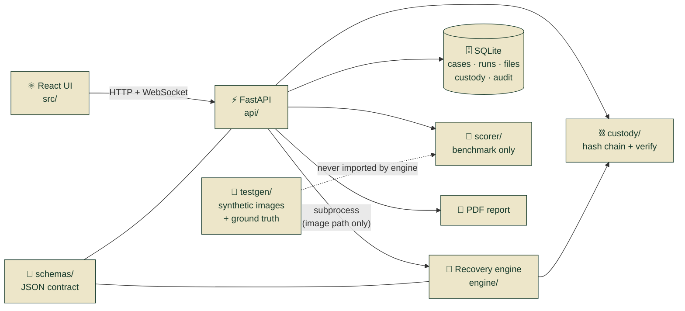
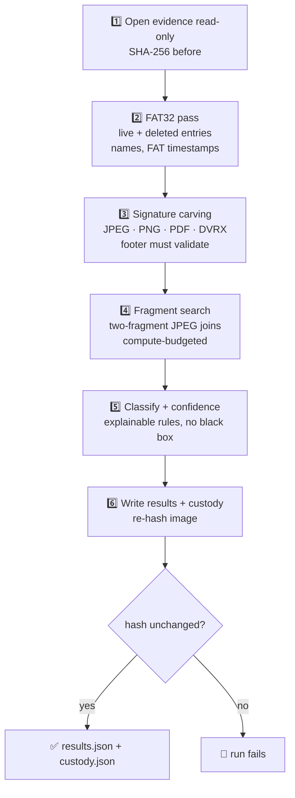
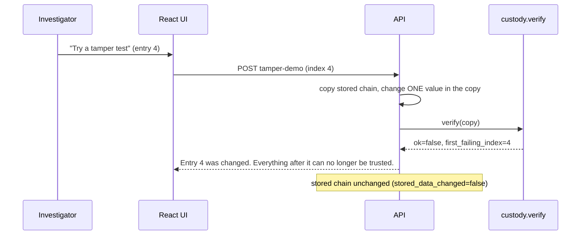

<!-- ============================ HERO ============================ -->
<div align="center">


<a href="https://github.com/1809gaurav/Trace-">
  
</a>

<br/>


**[Why](#-why-trace-exists) · [Demo](#-the-5-minute-demo) · [How it works](#-how-it-works) · [Proof](#-proof-by-numbers) · [Quick start](#-quick-start) · [API](#-api) · [Limits](#-honest-limitations)**

</div>

---

## 🕵️ Why Trace exists

> CCTV is often the **only witness**. When the drive is damaged, formatted or half-overwritten, the footage is gone, or worse, it is *recovered* and nobody can say how far to trust it.

Existing tools (Autopsy, PhotoRec, commercial suites) do parts of this well. Trace's bet is the **whole chain in one open pipeline**:

| | Typical recovery tool | **Trace** |
|---|---|---|
| Get files back | yes | yes (filesystem-aware **and** signature carving) |
| Tell you *how sure* it is | rarely | **every file**: label, confidence, one-sentence reason |
| Fragmented JPEGs | often come out broken | **2-fragment reconstruction**, validated by a full decode |
| Prove nothing was touched | separate hashing step | **evidence hashed before and after**, read-only handle |
| Show *who did what, when* | a spreadsheet | **hash-chained custody log** that fails visibly if edited |
| Court paperwork | typed by hand | **auto-generated PDF** with hashes, confidence, custody, limits |
| "Does it actually work?" | trust me | **scored against ground truth** (precision, recall, false positives) |

<div align="center">

### *We don't just return files. We return the proof.*

</div>

---

## ✨ At a glance

<table>
<tr>
<td width="33%" valign="top">

### 🔒 Evidence lock
Images open **read-only**. SHA-256 is taken on arrival and re-checked after every run. A mismatch fails the run loudly.

</td>
<td width="33%" valign="top">

### 🧩 Smart recovery
FAT32 directory walk, signature carving, bounded **two-fragment** JPEG joins, and a pluggable **DVR-like** container parser.

</td>
<td width="33%" valign="top">

### 🏷️ Honest labels
`intact` · `carved` · `reconstructed` · `partial`, each with a confidence band and a plain-language reason.

</td>
</tr>
<tr>
<td valign="top">

### ⛓️ Tamper-evident custody
One chain per case. Change a byte, a timestamp or an index and every later seal breaks, with the **first bad entry** named.

</td>
<td valign="top">

### 📄 Court-ready report
PDF with image fingerprint, per-file hash, confidence table, custody log and a **limitations** section.

</td>
<td valign="top">

### ♿ Built to be read
Cream-and-forest design, keyboard-first, skip link, live announcements, reduced-motion and high-contrast modes.

</td>
</tr>
</table>

---

## 🎬 The 5-minute demo

```text
  ┌────────────┐   ┌─────────────┐   ┌──────────────┐   ┌──────────────┐
  │ 1 UPLOAD   │──▶│ 2 LOCK      │──▶│ 3 RECOVER    │──▶│ 4 REVIEW     │
  │ damaged    │   │ read-only + │   │ live path,   │   │ labels, how- │
  │ disk image │   │ fingerprint │   │ files appear │   │ sure meters  │
  └────────────┘   └─────────────┘   └──────────────┘   └──────┬───────┘
                                                               │
  ┌────────────┐   ┌─────────────┐   ┌──────────────┐          ▼
  │ 7 REPORT   │◀──│ 6 TAMPER    │◀──│ 5 PROOF      │◀── before/after
  │ PDF to     │   │ TEST: edit  │   │ score card   │    slider for a
  │ download   │   │ 1 byte...   │   │ vs. truth    │    rebuilt JPEG
  └────────────┘   └─────────────┘   └──────────────┘
```

The moment judges remember: on the **Custody** page, press **Try a tamper test**:

```text
  ⛓  Entry 1  EVIDENCE_RECEIVED     ✅ sealed
  ⛓  Entry 2  IMAGE_OPENED          ✅ sealed
  ⛓  Entry 3  FILESYSTEM_PARSED     ✅ sealed
  ⛓  Entry 4  CARVING_DONE          ❌  CHANGED  ← one value edited in a COPY
  ⛓  Entry 5  FRAGMENTS_JOINED      ⚠️  can no longer be trusted
  ⛓  Entry 6  FILES_CLASSIFIED      ⚠️  can no longer be trusted
        ...
  "Entry 4 was changed. Everything after it can no longer be trusted."
  Stored data: untouched.
```

A ready-made talk track lives in [`docs/DEMO_SCRIPT.md`](docs/DEMO_SCRIPT.md).

---

## 🧠 How it works

### System map



> 🛡️ The engine runs as a **separate process** that receives only an image path. It never sees ground truth, and it never imports the generator or scorer (a test enforces this).

### The recovery pipeline



### Every file gets a label *and a reason*

| Label | Evidence behind it | Confidence band |
|---|---|---|
| 🟢 **intact** | directory entry present, chain or contiguity consistent, full decode passes | **0.88 – 1.00** (0.98 live, 0.92 deleted) |
| 🔵 **carved** | found by its signature, contiguous, full decode passes, no directory info | **0.70 – 0.85** |
| 🟡 **reconstructed** | fragments joined by search, full decode passes, the gap was inferred | **0.50 – 0.70** (lower when more candidates were tried) |
| ⚪ **partial** | part of the file decodes, full validation fails | **0.30 – 0.49** (scaled by decoded fraction) |

Confidence is **rule-based on purpose**: any score can be explained to a court in one sentence. The UI shows icon + text, never color alone.

---

## ⛓️ Chain of custody

```text
 ┌─────────────────────────┐        ┌─────────────────────────┐
 │ index   0               │        │ index   1               │
 │ time    2026-11-01T…Z   │        │ time    2026-11-01T…Z   │
 │ step    EVIDENCE_RECEIVED│       │ step    IMAGE_OPENED    │
 │ details {sha256, size}  │        │ details {path, size …}  │
 │ prev    0000…0000       │───┐    │ prev    ◀── a91c…       │
 │ hash    a91c…  ─────────┼───┴───▶│ hash    7be4…  ─────────┼──▶ …
 └─────────────────────────┘        └─────────────────────────┘
   hash = SHA-256( canonical JSON of {index, time, step, details, prev_hash} )
```

- **One chain per case:** upload → the engine's own steps → completion → report.
- `GET /verify` re-checks the whole chain and names the **first failing entry**.
- `POST /tamper-demo` edits an **in-memory copy only**; stored data is never touched (a test proves it).
- Contract **v1.1** hashes `index` and `time` too, so changing *only a timestamp* is caught. The older v1.0 formula did not cover them.



> ⚠️ **What the chain does and doesn't prove.** It proves order and unmodified content *since each entry was written*. It cannot, by itself, detect deletion of the **newest** entries unless the head hash is recorded somewhere else, and it is not a trusted timestamp authority.

---

## 📊 Proof by numbers

Measured on the project's own deterministic test images (seeds **1337, 7 and 42**). Every run: evidence hash unchanged, no schema errors.

| Scenario | What it stresses | Recovered | Precision | False positives | Time |
|---|---|:-:|:-:|:-:|:-:|
| **A** `clean_deleted` | deleted + live FAT32 files | 13 / 13 | 1.00 | 0 | ~1 s |
| **B** `corrupted_fs` | zeroed root dir, damaged FATs → pure carving | 13 / 13 | 1.00 | 0 | ~1 s |
| **C** `fragmented` | 2-fragment JPEGs with noise gaps | 6 / 6 | 1.00 | 0 | ~1 s |
| **D** `demo_mixed` | mixed media, DVR clips, decoys, overwritten files | 15 / 15 | 1.00 | 0 | ~1 s |
| **E** `empty_fs` | valid empty volume | 0 / 0 | n/a | 0 | <1 s |
| **F** `not_fat` | random bytes | 0 / 0 | n/a | 0 | <1 s |

<details>
<summary><b>🔍 Read this before quoting these numbers</b></summary>

- These images come from **this project's own FAT32 writer**, so the result shows the pipeline is correct *on the formats it was built for*. It is **not** evidence of performance on real-world disks.
- The engine never reads ground truth; it only gets an image path. The scorer is a separate package.
- Names and timestamps: carved files have **no names** (the directory is gone), so metadata accuracy is **0 %** on `corrupted_fs` and about **62 %** on `demo_mixed`. That is expected and reported, not hidden.
- Three-fragment files are out of scope and are not fabricated.

</details>

**Test suite:** `80` Python tests (engine, custody, scorer, schemas, API, and a **real-engine end-to-end test** through the HTTP API) plus frontend lint, a **color-policy check** and a strict TypeScript build.

---

## 🚀 Quick start

> Requirements: **Python 3.11+** and **Node.js 20+**. No root, no mounting; images are ordinary files.

<details open>
<summary><b>💻 Run locally (one command after setup)</b></summary>

```bash
# 1. Python deps
python -m venv .venv && source .venv/bin/activate        # Windows: .venv\Scripts\activate
pip install -r requirements-dev.txt

# 2. Frontend deps
npm ci

# 3. Config (never commit .env)
cp .env.example .env                                      # Windows: copy .env.example .env

# 4. Build UI, generate a synthetic demo image, run the REAL engine, serve everything
python run_demo.py --generate-demo --prerun
```

Open **http://127.0.0.1:8000** 🎉  The seeded demo case is a synthetic benchmark, so its Results page shows a real score from the real scorer. Upload your own image on the home page to run the engine on it (no score is shown for real evidence, because there is no ground truth).

Useful flags: `--reset` (clear demo data under `DATA_DIR` only), `--no-build` (serve existing `dist/`), `--host` / `--port`, `--reload`.

</details>

<details>
<summary><b>🐳 Run with Docker</b></summary>

```bash
docker compose up --build        # → http://localhost:8000
```

Multi-stage build: React → static bundle, Python runtime with the engine, a generated demo image, migrations and a pre-run on start. Data lives in the `trace-data` volume. See [`docs/DEPLOY.md`](docs/DEPLOY.md) for hosting and security settings.

</details>

<details>
<summary><b>🎨 Frontend only</b></summary>

```bash
npm run dev                      # Vite proxies /api and WebSocket to :8000
VITE_USE_MOCK=true npm run dev   # original in-memory mock, no backend needed
```

</details>

<details>
<summary><b>🧪 Generate test images, run the engine, score it</b></summary>

```bash
python -m testgen.make_image --out testdata --seed 1337              # scenarios A-F
python -m testgen.make_image --out testdata --seed 7 --only A,C

python -m engine.pipeline --image testdata/demo_mixed/disk.img --out out --progress jsonl

python -m scorer.score \
  --truth testdata/demo_mixed/ground_truth.json \
  --results out/results.json --recovered-dir out \
  --image testdata/demo_mixed/disk.img --json score.json --strict

python -m custody.verify out/custody.json            # verify a chain from the CLI
python -m custody.verify out/custody.json --tamper 2 # shows the break, writes nothing
```

</details>

<details>
<summary><b>✅ Tests</b></summary>

```bash
python -m pytest -q            # 80 tests, about 30 s
npm run lint                   # color policy + oxlint
npm run build                  # strict TypeScript + production bundle
```

</details>

---

## 🧱 Project map

```text
Trace/
├── engine/      🔬 read-only recovery: fat32, carver, fragments, dvrlike, classifier, pipeline
├── custody/     ⛓️  hash chain + verifier + tamper helpers (contract v1.1)
├── schemas/     📜 Pydantic models + JSON Schemas (results, custody, ground truth, score)
├── scorer/      📏 precision · recall · completeness · calibration vs ground truth
├── testgen/     🧪 deterministic FAT32 + DVR-like images, scenarios A–F, FAT32 writer
├── api/         ⚡ FastAPI, SQLAlchemy models, Alembic migration, job runner, report
├── src/         ⚛️  React + TypeScript + Tailwind interface (cream × forest green)
├── tests/       ✅ engine · custody · scorer · schemas · API · real-engine end to end
├── docs/        📚 DEPLOY.md · DEMO_SCRIPT.md
├── Dockerfile · docker-compose.yml · .github/workflows/ci.yml
└── run_demo.py  🎛️  migrate → seed → pre-run → serve (one process)
```

---

## 🔌 API

Interactive docs at **`/docs`**. Errors always look like `{ "error": { "code", "message", "details" } }`, in plain language.

| Method | Path | What it does |
|---|---|---|
| `POST` | `/api/cases` | create a case |
| `POST` | `/api/cases/{id}/upload` | stream, hash and **lock** an evidence image |
| `POST` | `/api/cases/{id}/runs` | start recovery (background job) |
| `WS` | `/api/ws/cases/{id}` | live progress, replay with `?after_seq=N` |
| `GET` | `/api/cases/{id}/results` | filter · sort · page recovered files |
| `GET` | `/api/cases/{id}/files/{fid}/content` · `/preview` · `/hex` | download · inline preview · bounded hex of the **original** evidence |
| `GET` | `/api/cases/{id}/custody` · `/verify` | read · verify the chain |
| `POST` | `/api/cases/{id}/tamper-demo` | verify a **changed copy**, store nothing |
| `POST` `GET` | `/api/cases/{id}/report` | generate · download the PDF |
| `GET` | `/api/cases/{id}/score` | benchmark score (demo images only) |
| `GET` | `/api/health` · `/api/version` | status |

Every response carries `X-Trace-Engine: real` or `fake`; the UI shows a **Demo data** pill for `fake`.

<details>
<summary><b>⚙️ Configuration (environment variables)</b></summary>

| Variable | Default | Notes |
|---|---|---|
| `DATA_DIR` | `./data` | database, evidence, run outputs, reports; **persist this** |
| `ENGINE_MODE` | `fake` in code, `real` in `.env.example` | `fake` produces clearly synthetic output |
| `AUTH_MODE` | `none` | `none` (local only) · `apikey` · `jwt` |
| `API_KEY` / `JWT_SECRET` / `DEMO_USERNAME` / `DEMO_PASSWORD` | empty | required for the matching auth mode; keep in `.env`, never in git |
| `DEMO_MODE` | `true` | attaches benchmark ground truth to the seeded demo case only |
| `MAX_UPLOAD_SIZE` | 2 GiB | streamed in 1 MiB chunks |
| `CORS_ORIGINS` | `["http://localhost:5173"]` | restrict on public hosts |
| `DATABASE_URL` | SQLite under `DATA_DIR` | other SQLAlchemy URLs work (no SQLite-only SQL) |
| `HOST` / `PORT` | `127.0.0.1` / `8000` | use `0.0.0.0` in containers |

</details>

---

## 🛡️ Evidence safety, by design

- 🔒 Evidence is opened with a **read-only handle**; any write attempt raises.
- 🧮 SHA-256 **before and after** every run, stored with the run; mismatch → failed run.
- 🧱 Stored uploads are marked read-only where the OS allows it; case deletion is **soft**.
- 🧷 Paths are resolved and confined to `DATA_DIR`; filenames from clients are never trusted.
- 📏 The hex viewer is bounds-checked (max 512 bytes per request) and read-only.
- 🧾 An **audit log** records uploads, runs, verifications, tamper demos and downloads.
- 🙈 `.env` is git-ignored; only `.env.example` (placeholders) is tracked.

---

## ♿ Design & accessibility

- Palette sampled from a reference design: **cream** `#F5F0DC`, **forest** `#173A2B`, **leaf** `#1F5A40`; a build-time **color-policy check** rejects any color outside the token list.
- Large type, plain language ("Evidence locked", "How sure we are"), technical detail tucked behind *Show technical details*.
- Keyboard-first: skip link, visible focus rings, focus-trapped drawer, `aria-live` progress.
- Motion is optional: custom cursor and the radar background switch off for **reduced motion**, touch devices and the in-app *Playful motion* toggle; a *Pause animation* button is always available.
- Status is never color alone: every label has an **icon and text**.

---

## 🚧 Honest limitations

| Area | Today | Why it matters |
|---|---|---|
| Filesystems | **FAT32** only | no NTFS, exFAT, ext4 yet |
| DVR formats | a **self-defined** DVR-like container (pluggable parser) | **no real vendor format is decoded** |
| Fragments | exactly **two** fragments | three or more are partial or skipped, never invented |
| Benchmark | synthetic images from the project's own writer | not a measure of real-world disks |
| Legal | "court-ready **format**" | **not** a legal certification or accredited tool |
| Custody | proves order + unmodified content since written | newest-entry truncation needs an external head anchor; not a trusted timestamp |
| Auth | `none` is for local demos | use `apikey` / `jwt` publicly; the UI has **no login form yet** |
| Scale | one process, SQLite, one job at a time by default | fine for a demo and a single lab, not a multi-tenant service |

---

## 🗺️ Roadmap

- [x] Read-only evidence handling with before/after hashing
- [x] FAT32 + carving + 2-fragment JPEG reconstruction
- [x] Explainable classification and confidence
- [x] Hash-chained custody v1.1 (index + time covered) and tamper demo
- [x] Auto-generated PDF report
- [x] Real-engine end-to-end test through the API
- [ ] Login screen for `apikey` / `jwt` modes
- [ ] NTFS and exFAT parsers
- [ ] Real DVR/NVR vendor container plug-ins
- [ ] Pixel-continuity scoring for fragment joins
- [ ] Signed reports with an external timestamp anchor
- [ ] Postgres profile and multi-worker job queue

---

## ❓ FAQ

<details>
<summary><b>"Autopsy and PhotoRec already exist. What is new?"</b></summary>

They recover files. Trace adds, in one open pipeline: a **confidence and reason for every file**, **fragment reconstruction**, a **tamper-evident custody chain**, an **auto-generated report**, and a **measured benchmark**. We don't claim nobody does any one of these; we claim the combination, with proof.

</details>

<details>
<summary><b>"Does it work on real DVRs?"</b></summary>

Not yet. The parser interface is pluggable and a synthetic container ships as the example. Real vendor formats are roadmap items, and the README says so.

</details>

<details>
<summary><b>"Why rule-based confidence instead of ML?"</b></summary>

Because an examiner has to defend it. Every score maps to explicit evidence ("found by its signature; the whole image decodes; the name and dates were lost"), so it can be explained in one sentence.

</details>

<details>
<summary><b>"Is the fake engine safe to demo?"</b></summary>

Only if you say so. Fake runs are labelled in headers and in the UI (**Demo data**). Never present them as recovered evidence.

</details>

---

## 🤝 Contributing

1. Branch from `main` (`feat/…`).
2. Add or update tests; run `python -m pytest -q`, `npm run lint`, `npm run build`.
3. Never commit `.env`, databases, evidence images or `node_modules`.
4. Open a PR; CI runs the backend tests and the frontend lint and build.

**License:** not chosen yet. Add a `LICENSE` file before publishing publicly.

---

<div align="center">


**Built for the "Court-Admissible Forensic Data Recovery" hackathon track · SDG 16**

*Recovered data is evidence only when every byte can prove itself.*

</div>
